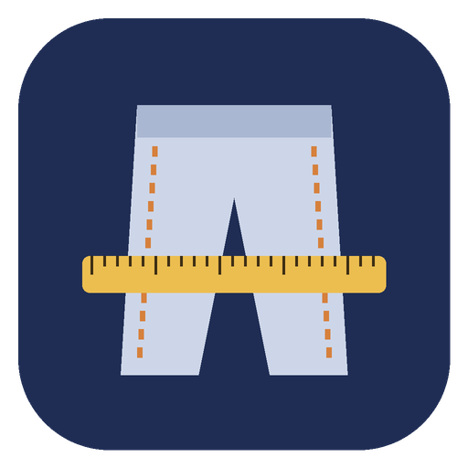
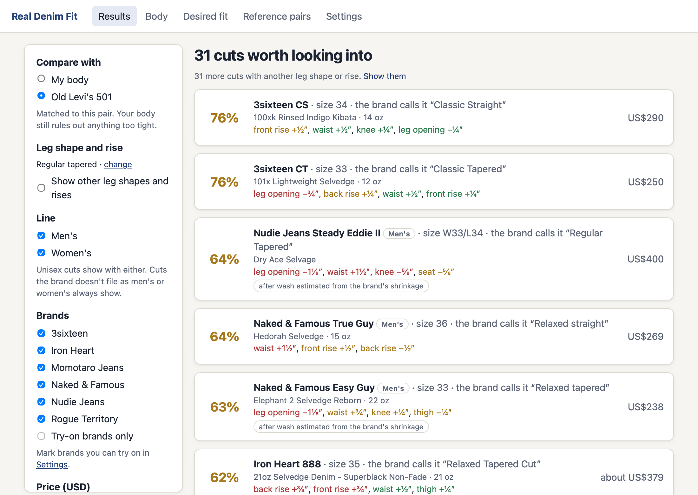
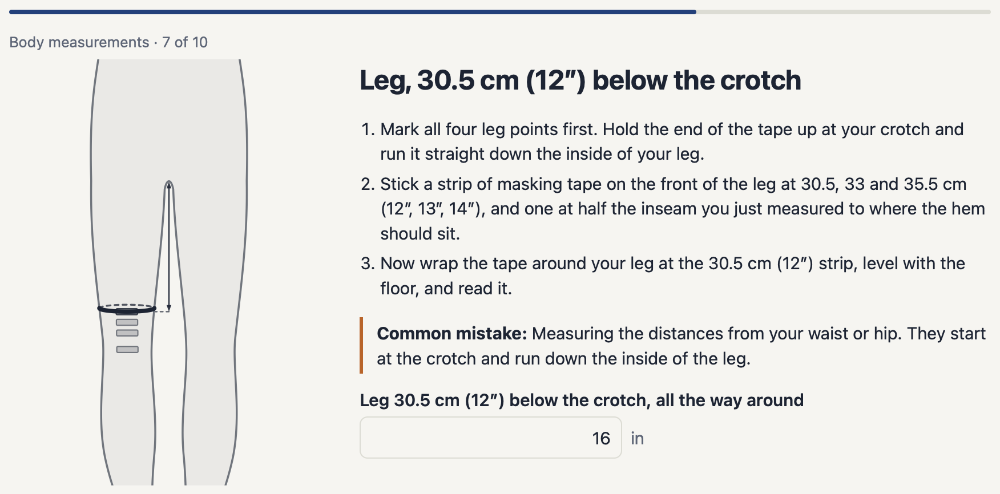
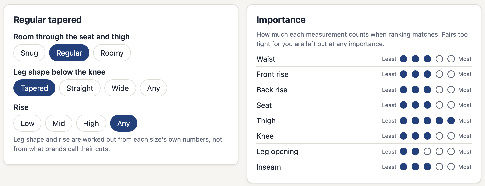
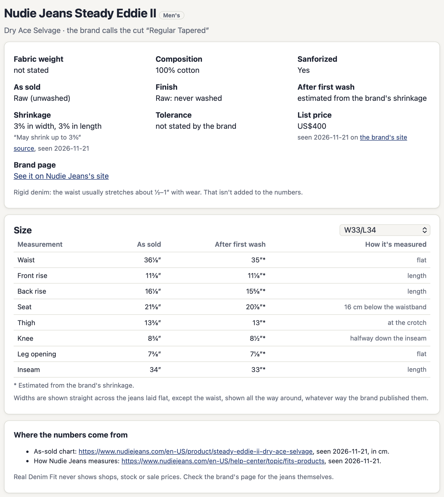
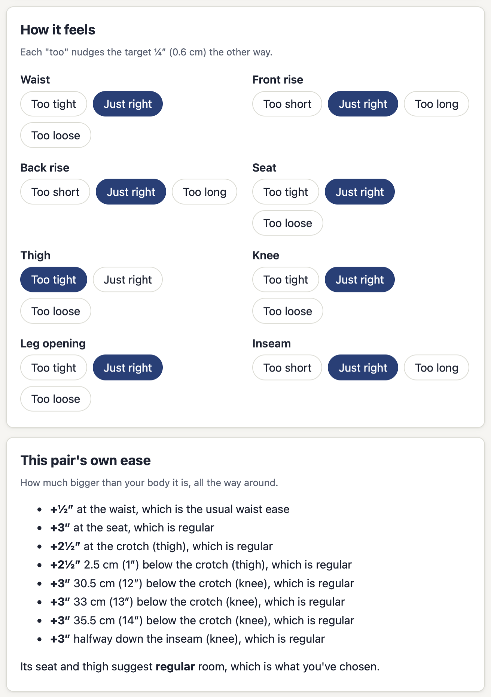

<h1 align="center">Real Denim Fit</h1>

<h3 align="center">Your size in every brand's raw denim.</h3>

Measure yourself once, choose how you want your jeans to fit, and see which raw denim
jeans from six brands come closest, and in which size. Free for Mac and Windows, and your
measurements never leave your computer.

  <a href="https://github.com/DigitalN/Real-Denim-Fit/releases/latest"><b>Download for Mac or Windows</b></a>
  &nbsp;·&nbsp; <a href="#how-it-works">How it works</a>
  &nbsp;·&nbsp; <a href="#no-account-no-shop-links-nothing-sent">Privacy</a>

<picture>
  <source media="(prefers-color-scheme: dark)" srcset="docs/screenshots/results-dark.png">
  
</picture>

The body in these pictures is an example. The jeans and their measurements are real, taken from each brand's own site.

## How it works

1. **Measure yourself.** A guide takes you through it one measurement per screen, with a soft
   tape and a few strips of masking tape.
2. **Choose your desired fit:** how much room through the seat and thigh, the leg shape and
   the rise.
3. **See your matches.** Each cut shows its closest size, its closeness, and how far off each
   measurement is, in centimetres or inches.

## Measure once, at every brand's points

> “Leg, 30.5 cm (12″) below the crotch”

Brands measure the knee at different heights: 12″, 13″ or 14″ below the crotch, or halfway
down the inseam. So the guide asks for your leg at each one, and every brand is compared at
its own point. Each screen has a drawing, where the tape goes and the most common mistake.

<picture>
  <source media="(prefers-color-scheme: dark)" srcset="docs/screenshots/guide-dark.png">
  
</picture>

## Say how you want them to fit

> “Leg shape and rise are worked out from each size's own numbers, not from what brands call their cuts.”

Pick the room (snug, regular or roomy), the leg shape and the rise, and the app gives the
combination its usual name, such as "slim tapered". Five dots for each measurement set how
much it counts. Anything too tight for you is left out, however little it counts.

<picture>
  <source media="(prefers-color-scheme: dark)" srcset="docs/screenshots/fit-dark.png">
  
</picture>

## Judged after the first wash

> “after wash estimated from the brand's shrinkage”

Raw denim shrinks. Every pair is compared as it will be after its first wash: from the brand's
own after-wash measurements where it publishes them, otherwise from the shrinkage it states.
Each product shows its as-sold and after-wash measurements side by side, and links every
number to the page it came from, with the date it was seen.

<picture>
  <source media="(prefers-color-scheme: dark)" srcset="docs/screenshots/product-dark.png">
  
</picture>

## Know a pair that fits? Add it

> “+2½″ at the crotch (thigh), which is regular”

Measure a pair you own, laid flat, or pick one from the catalogue, even one you've only tried
on in a shop. Say how it feels at each measurement, and your matches aim at that pair, nudged
wherever it's too tight or too loose. The app also shows the pair's own ease and the room it
suggests.

<picture>
  <source media="(prefers-color-scheme: dark)" srcset="docs/screenshots/pair-dark.png">
  
</picture>

## Also

- **Six brands:** Iron Heart, Naked & Famous, 3sixteen, Nudie, Momotaro and Rogue Territory.
- **Filters:** sanforized only, no stretch, fabric weight, and price, converted to your
  currency.
- **Centimetres or inches,** in ⅛″ steps. Switch any time.
- **Men's and women's cuts,** as each brand files them.

## No account, no shop links, nothing sent

What you enter stays on your computer. There's no account, no analytics and no crash reports.

The app shows no shop links, stock, sale prices or product photos: just each brand's list price
and a link to its own page ([ADR 0003](docs/adr/0003-no-shopping-information.md),
[ADR 0007](docs/adr/0007-no-product-photos.md)). The only thing it sends over the internet is
a check for updates when it opens.

## Why an app?

A website costs money to host and work to keep running. An app doesn't: you download it once
and it runs on your computer. It's open source, so if you'd like it as a website, you're
welcome to take it and host it yourself. The screens are plain HTML, CSS and JavaScript, and
[preview.rs](src-tauri/examples/preview.rs) already serves them to a browser with the same Rust
behind them.

## Install

Download it from the [latest release](https://github.com/DigitalN/Real-Denim-Fit/releases/latest).

### macOS (Apple silicon and Intel)

1. Open `Real-Denim-Fit-…-macOS-universal.dmg` and drag **Real Denim Fit** into **Applications**.
2. Open it. The first time, macOS says it can't verify the app, because it isn't paid-signed
   with Apple. Click **Done** (not Move to Trash).
3. In **System Settings → Privacy & Security**, click **Open Anyway** next to the message about
   Real Denim Fit. Only once.

### Windows (64-bit, including ARM laptops)

1. Run `Real-Denim-Fit-…-Windows-x64-setup.exe`.
2. Windows may say **"Windows protected your PC"**, because the installer isn't paid-signed.
   Click **More info**, then **Run anyway**. Only once.
3. The installer doesn't need administrator rights.

It updates itself from then on, checking each update against the project's signing key.

## Licence

Free and open source under the [GNU GPL v3](LICENSE): use it, change it and share it, but what
you share stays open too. To build it yourself, see [repo-layout.md](docs/repo-layout.md#building).
